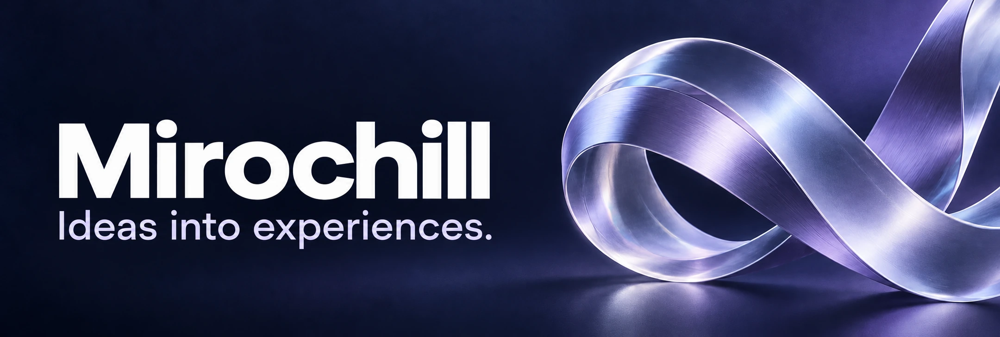

  <strong>Hey, I'm Miro — creative strategist &amp; AI-native maker from France.</strong> 
  I turn ambitious ideas into clear products, memorable interfaces, and working prototypes.

  <a href="#selected-work">Selected work</a> &nbsp;·&nbsp;
  <a href="#from-idea-to-direction">Creative approach</a> &nbsp;·&nbsp;
  <a href="https://github.com/Mirochill?tab=repositories">All projects</a>

## Selected work

### [Browser Pilot](https://github.com/Mirochill/browser-pilot)

Background Chrome control for ChatGPT, with a self-hosted MCP relay and native browser interactions.

### [Codex Native Selector](https://github.com/Mirochill/codex-native-selector)

A clearer model selector for Codex Desktop, built as a local customization on Windows and macOS.

### [Mini Wallpaper](https://github.com/Mirochill/mini-wallpaper)

A lightweight native Windows app that brings local videos and GIFs to the desktop, with automatic media optimization.

### [MiniSnip](https://github.com/Mirochill/MiniSnip)

A focused Windows screenshot tool that copies captures straight to the clipboard.

## From idea to direction

Most of my work starts before the build: finding the angle, defining what the experience should communicate, and giving the project a coherent identity. AI helps me explore and prototype quickly; each decision still serves a clear creative direction.

- **Shape the product** — concept, value, creative identity, and experience strategy.
- **Make it tangible** — interfaces and working prototypes that can be tested, challenged, and improved.

## Current playground

**AI-first products** that make powerful models feel useful and natural. 
**Creative interfaces** with a strong visual identity and intentional interactions. 
**Interactive worlds** built around atmosphere, curiosity, and discovery.

---

  Creative direction · interface design · AI-native prototyping 
  <a href="https://github.com/Mirochill?tab=repositories"><strong>Explore the projects</strong></a>

