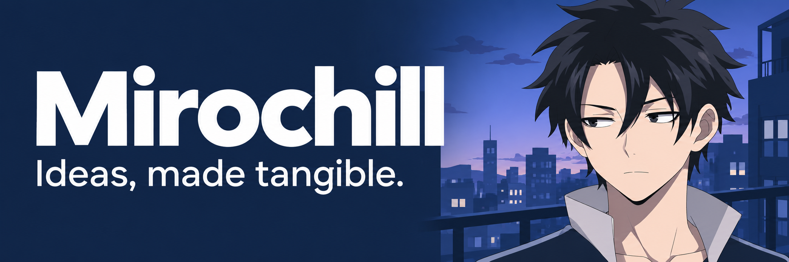

  <strong>Hey, I'm Miro.</strong> 
  Creative strategist &amp; AI-native maker from France.

  I explore ideas, shape interfaces, and turn creative direction into working prototypes.

## What drives me

A good idea deserves a clear identity and an experience that makes sense. I use AI to explore possibilities and make them tangible, then refine the concept, the visuals, and the details that make it feel right.

## Where my curiosity goes

- **AI &amp; open source** — Useful tools, new workflows, and accessible alternatives to everyday software.
- **Interfaces &amp; visual identity** — Clear layouts, intentional interactions, and a distinct point of view.
- **3D &amp; interactive worlds** — Atmosphere, experimentation, and experiences worth exploring.

---

  <a href="https://github.com/Mirochill?tab=repositories"><strong>Explore my repositories</strong></a>

